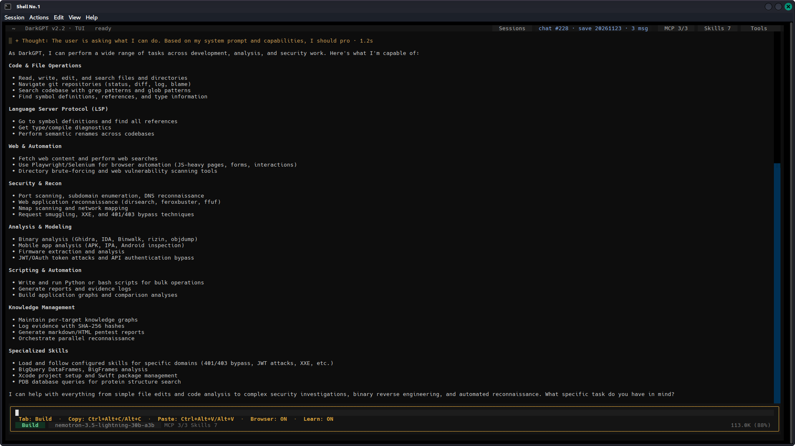

<div align="center">

# ⚡ DarkGPT CLI

**The terminal AI agent that codes, investigates, learns from its mistakes, and builds proof-first security reports.**

[](LICENSE)
[](https://www.python.org/)
[](https://textual.textualize.io/)
[](https://modelcontextprotocol.io/)
[](#contributing)

[Quickstart](#-quickstart) | [Features](#-what-makes-it-different) | [Security Mode](#-security--recon-mode) | [Commands](#-command-cheatsheet) | [Contributing](#-contributing)

<br/>



</div>

---

## Why DarkGPT?

Most AI CLIs can chat about code. **DarkGPT works inside your terminal like an operator**: it reads files, runs tools, browses JS-heavy sites, spawns subagents, remembers lessons, tracks target state, and produces evidence-backed reports.

- **For developers:** native tool-calling agent with LSP, git, diffs, undo, verify/review loops, scripts, checkpoints.
- **For security researchers:** HackSkills routing, target knowledge graph, append-only evidence ledger, proof-first reporting, parallel recon orchestration.
- **For power users:** MCP servers, browser automation, self-learning patterns, session resume, permission/hook controls.

> ⚠️ **Authorized use only.** DarkGPT is built for systems you own or have explicit written permission to test.

## 🚀 Quickstart

```bash
git clone https://github.com/sharma5pac/DARK-GPT-CLI-.git
cd DARK-GPT-CLI-
python -m venv .venv
source .venv/bin/activate
pip install -r requirements.txt

cp .env.example .env
# add your keys in .env

./darkgpt
```

### Minimal `.env`

```env
OPENROUTER_API_KEY=your-openrouter-key-here
# optional
NVIDIA_API_KEY=your-nvidia-key-here
```

## ✨ What Makes It Different

| Capability | What it does |
|---|---|
| **Native tool calling first** | Uses structured tool calls; controlled ReAct fallback (`/react on|off`) instead of silent degradation |
| **Self-learning memory** | Captures durable lessons/patterns from failures and repeated signals; injects them into future turns |
| **HackSkills engine** | Active security skill router with deep topic skills for recon, API, auth, injection, cloud, AD, mobile, binary, and more |
| **Browser automation** | Real browser actions (Playwright -> Selenium fallback) for JS-heavy pages, forms, clicks, extraction, screenshots |
| **MCP-native** | Connect stdio/HTTP MCP servers; discover and call tools; per-server toggles |
| **Universal neutral router** | One read-only `neutral_route` decision across built-in tools, MCP servers, active skills and local binaries; opt-in execution runs at most one gated call |
| **Proof-first security workflow** | Findings tracked as `attempted/proved/false_positive` with evidence refs, repro, impact, remediation |
| **Operator UX** | Textual TUI, streaming phases, tool cards, diff cards, undo, sessions/checkpoints, copy/paste |

## 🧠 Security / Recon Mode

Set a target and DarkGPT builds a persistent investigation state:

```text
/target example.com
/recon
/kg
/evidence
/report md
```

### What gets built automatically

- **Knowledge graph** - `hosts -> services -> endpoints -> findings` in `~/.config/darkgpt/targets/<slug>/graph.json`
- **Evidence ledger** - append-only `evidence.jsonl` with SHA-256, timestamps, redacted previews, tool args/results
- **Report** - Markdown/HTML report from graph + evidence with proved vs attempted separation

### Core pentest reasoning

- **Dynamic state management** - active target state injected into context every turn
- **Adaptive hypothesis loop** - every probe is a hypothesis; on block/failure, pivot and record the lesson
- **Multi-agent orchestration** - `recon`, `vuln_analysis`, `exploit_validation`, `reporting` subagent roles
- **Vulnerability chaining** - correlate findings across assets and workflows
- **Proof-first boundary** - no "proved" without reproducible evidence

## 🛠 Developer Mode

DarkGPT is also a serious coding agent:

- `read/write/edit/patch/apply_patch` with diff preview and undo
- LSP definitions/references/diagnostics/rename
- git status/diff/log/blame
- verify/review loops and test feedback
- isolated read-only subagents for explore/review/test
- project rules (`CLAUDE.md`, `AGENTS.md`, `DARKGPT.md`, `.darkgpt/rules.md`)
- hooks + permissions (`full` / `ask` / `strict`)
- bounded helper scripts saved as evidence

## ⌨️ Command Cheatsheet

| Command | What it does |
|---|---|
| `/model` `/provider` | Pick model/provider |
| `/target <name>` | Set active recon target |
| `/targets` `/kg` `/evidence` `/report` | Inspect graph, evidence, generate report |
| `/recon [focus]` | Run parallel recon orchestration |
| `/skills` `/mcp` `/tools` | Manage skills, MCP servers, tools |
| `/neutral [decide\|auto] <goal> [:: <json>]` | Route across tools, MCP, skills and local binaries; `auto` runs one gated call |
| `/math [decide\|auto] <goal>` | Math-for-attacks route, bounded computation and proof-status checks |
| `/lessons` `/patterns` `/learn` | Self-learning controls |
| `/diff` `/undo` `/verify` `/review` | Safe code-change workflow |
| `/checkpoint` `/sessions` `/resume` | Session state management |
| `/permissions` `/hooks` | Runtime safety controls |
| `/help` | Full command palette |

## 🧩 Architecture

```text
User prompt
   │
   ▼
Textual TUI --► Agent Core (native tools / controlled fallback)
                    │
                    ├- Tool Registry (fs, git, lsp, shell, browser, MCP, scripts)
                    ├- Skill Registry (HackSkills + custom skills)
                    ├- Self-Learning (lessons/patterns)
                    ├- Subagents (recon/vuln/validation/reporting/explore/review/test)
                    ├- Knowledge Graph (target state)
                    └- Evidence Ledger + Report Generator
```

## 🔒 Safety & Responsible Use

- Only test assets you own or are explicitly authorized to assess.
- Treat evidence, reports, tokens, cookies, and dumps as sensitive.
- `.env` and local runtime data are ignored by git; keep secrets out of commits.
- Review findings manually before acting on "proved" claims.

## 🤝 Contributing

PRs are welcome. High-impact areas:

- new MCP integrations
- recon adapters and parsers
- report templates
- skill packs
- UI/UX improvements
- tests and evals

```bash
# dev setup
python -m venv .venv && source .venv/bin/activate
pip install -r requirements.txt
python -m compileall agent utils tui tests
```

## ⭐ Support the Project

If DarkGPT saves you time in the terminal, **star the repo** and share it with builders/security folks who want an agent that actually does the work.

## License

MIT - see [LICENSE](LICENSE).
